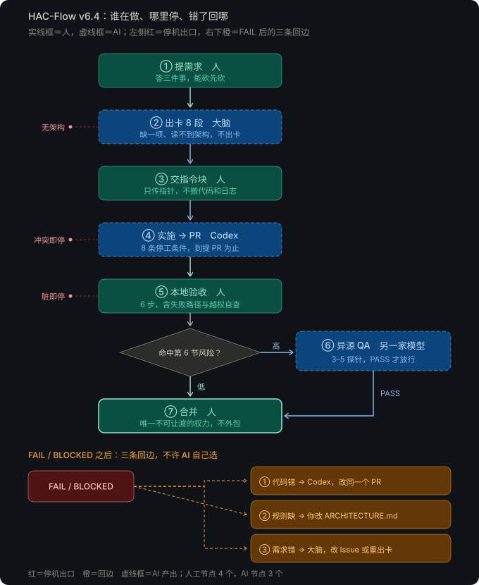

# HAC-Flow · v6.4

一人开发流水线：规划大脑出卡建 Issue → 本地 Codex 实施 → Human 本地验收 → 高风险任务异源 QA → Human 合并。
无标签、无后台脚本、无任务卡格式审查。

## 角色
- **规划大脑（ChatGPT）**：质疑需求，读项目 ARCHITECTURE.md，建 Issue，回复 Issue 链接和一个执行指令块；高风险 PR 时出质检指令。
- **执行（本地 Codex）**：读 AGENTS.md，建分支、先写测试、写代码、提 PR。到提 PR 为止。
- **异源 QA（WorkBuddy / DeepSeek）**：只处理高风险 PR，在新对话里按质检指令写独立探针实跑，输出 PASS / FAIL / BLOCKED 和证据。
- **Human**：确认任务，本地实跑验收，决定合并。

## 流程
1. **立项（仅首次）**：大脑读 templates/ARCHITECTURE_TEMPLATE.md 生成项目 ARCHITECTURE.md，Human 提交到 main。
2. **出卡**：大脑建 Issue，回复 Issue 链接和执行指令块。
3. **开发**：Human 把指令块交给 Codex，Codex 提 PR。
4. **验收**：低风险 Human 看 Diff 并实跑；高风险再对大脑说"出质检指令"，把输出贴到新对话。风险区域以项目 ARCHITECTURE.md 第 6 节为准。
5. **合并**：对照 templates/MERGE_CHECKLIST.md，Squash and merge。

## 流程图

实线框为人工节点（提需求、交指令块、本地验收、合并），虚线框为 AI 节点（出卡、实施、异源 QA）。左侧红色为停机出口，橙色为 FAIL / BLOCKED 后的三条回边：代码错回 Codex、规则缺由 Human 改架构、需求错回大脑。

## 文件与部署位置
| 文件 | 部署到 |
| :--- | :--- |
| prompts/chatgpt-brain.md | GPT 设置（自定义指令）。先填两处【】：项目仓库名、项目本地路径 |
| prompts/codex-executor.md | `~/.codex/AGENTS.md`（全局）或项目根目录 `AGENTS.md`，二选一，不要两处都放 |
| prompts/workbuddy-global.md | WorkBuddy 全局指令 |
| prompts/qa-prompt.md | 不部署。大脑出质检指令时读取 |
| templates/ARCHITECTURE_TEMPLATE.md | 不部署。新项目生成 ARCHITECTURE.md 时读取 |
| templates/MERGE_CHECKLIST.md | 不部署。合并前对照 |

## 维护
- 只在本仓库改规则，再复制到部署位置；不直接改 GPT 设置或本地 AGENTS.md。
- 改完验证：问 GPT"任务卡模板有哪几个二级标题"；Codex 运行 `codex --ask-for-approval never "Summarize the current instructions."` 看它复述的内容。
- 已有项目的 ARCHITECTURE.md 是一次性实例，模板改了要手动补。
- 同类问题漏过两次，才加规则；每跑完 10 张卡扫一遍，删掉从没触发过的规则。
