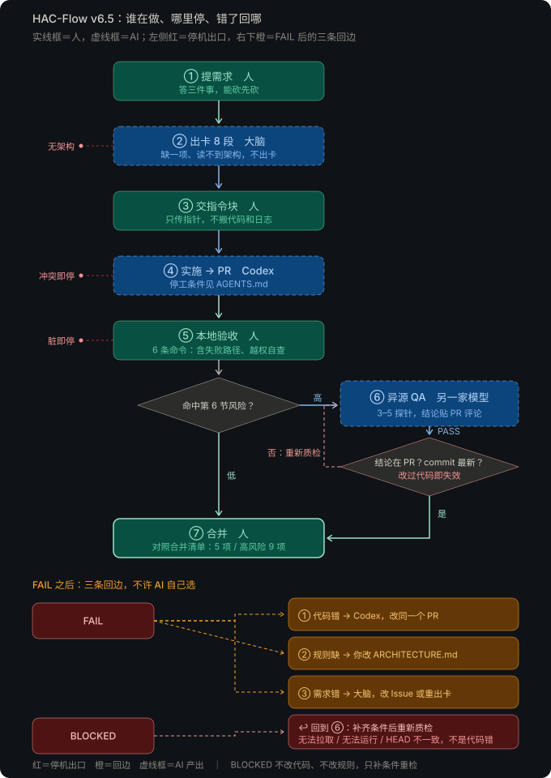

# HAC-Flow · v6.7

一人开发流水线：规划大脑出卡建 Issue → 本地 Codex 实施 → Human 本地验收 → 高风险任务异源 QA → Human 合并。
无标签、无后台脚本、无任务卡格式审查。

## 角色

| 岗位 | 做什么 | 不做什么 |
|---|---|---|
| 人（Human） | 定需求、批准架构修订、本地验收、合并 | — |
| 小助手（WorkBuddy） | 审阅、核对、整理、给建议 | 不执行、不写文件、不推送、不出卡、不做质检 |
| 大脑（ChatGPT） | 质疑需求、出卡、建 Issue、出质检指令 | 不写代码、不跑测试、不 merge |
| 执行（本地 Codex） | 建 `task/N` 分支、先写测试、写代码、提 PR | 不 merge，不改红牌，不改 main |
| 质检员（DeepSeek） | 只读 PR，跑探针，输出 PASS / FAIL / BLOCKED | 不写仓库，不发评论 |

## 交接格式（NEXT）

大脑、小助手、Codex 的每段输出，最后一行（代码块之外）必须是 NEXT 行。传话的人只看这一行。

| NEXT 行 | 你做什么 |
|---|---|
| `NEXT: 交 Codex（粘贴上面的执行指令块）` | 到 Codex 新会话粘贴指令块 |
| `NEXT: 交质检员（粘贴上面的质检指令块；拿到结论后原样贴到 PR 评论，再对大脑发"下一步"）` | 到 DeepSeek 新对话粘贴 |
| `NEXT: 交大脑（回复"A"）` 或 `（粘贴本段）` | 回到大脑窗口，按括号写的回复或粘贴 |
| `NEXT: 人工验收（……）` | 本地拉分支实跑；通过后按合并清单合并 |
| `NEXT: 停，等你决定` | 从 A/B 里选一个，回复给输出这条 NEXT 的那个窗口；每个选项附推荐，回"默认"即采纳 |

规则：
- 括号里必须写清你要粘贴或回复的内容。
- NEXT 行不得写进代码块（代码块会被整段粘贴给下一个 AI）。
- 质检员的输出不加 NEXT（PASS / FAIL / BLOCKED 要被评论和脚本解析），它的去向固定为"贴到 PR 评论"，由大脑的 NEXT 行说明。
- 凡需要你选择，必须给 A/B 和推荐，不问"要不要……"。

## 流程
1. **立项（仅首次）**：大脑读 templates/ARCHITECTURE_TEMPLATE.md 生成项目 ARCHITECTURE.md，Human 提交到 main。
2. **出卡**：大脑建 Issue，回复 Issue 链接和执行指令块。
3. **开发**：Human 把指令块交给 Codex，Codex 提 PR。
4. **验收**：低风险 Human 看 Diff 并实跑；高风险再对大脑发"质检：<PR 链接>"，把输出贴到 DeepSeek 新对话。风险区域以项目 ARCHITECTURE.md 第 6 节为准。
5. **合并**：对照 templates/MERGE_CHECKLIST.md，Squash and merge。

## 流程图

实线框为人工节点（提需求、交指令块、本地验收、合并），虚线框为 AI 节点（出卡、实施、异源 QA）。左侧红色为停机出口，橙色为 FAIL 后的三条回边：代码错回 Codex、规则缺由 Human 改架构、需求错回大脑。BLOCKED 表示无法验证（无法拉取 / 无法运行 / HEAD 不一致），补齐条件后回到异源 QA 重新质检，不改代码、不改规则。高风险卡在合并前多一道门禁：QA 结论须已贴到 PR 评论，且被测 commit 等于 PR 最新 commit；改过代码即视为失效，重新质检。

## 文件与部署位置
| 文件 | 部署到 |
| :--- | :--- |
| prompts/chatgpt-brain.md | GPT 设置（自定义指令）。先填两处【】：项目仓库名、项目本地路径 |
| prompts/codex-executor.md | `~/.codex/AGENTS.md`（全局）或项目根目录 `AGENTS.md`，二选一，不要两处都放 |
| prompts/workbuddy-global.md | WorkBuddy 全局指令 |
| prompts/qa-prompt.md | 不部署。大脑出质检指令时读取 |
| templates/ARCHITECTURE_TEMPLATE.md | 不部署。新项目生成 ARCHITECTURE.md 时读取 |
| templates/MERGE_CHECKLIST.md | 不部署。合并前对照 |

## 维护
- 只在本仓库改规则，再复制到部署位置；不直接改 GPT 设置或本地 AGENTS.md。
- 改完验证：问 GPT"任务卡模板有哪几个二级标题"；Codex 运行 `codex --ask-for-approval never "Summarize the current instructions."` 看它复述的内容。
- 已有项目的 ARCHITECTURE.md 是一次性实例，模板改了要手动补。
- 同类问题漏过两次，才加规则；每跑完 10 张卡扫一遍，删掉从没触发过的规则。
